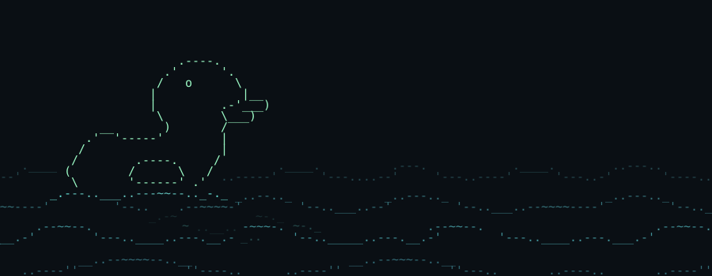

# Hello!

## About Me

I'm a nerd who likes computers, programming, cybersecurity, playing CTF's and Space.

I have experience in Python, C, C++, Java, Bash, html, make, react, nodejs; and starting to learn x86 and Rust.

Currently exploring Reverse Engineering and Binary Exploitation while doing my Master's to specialize in Cybersecurity.