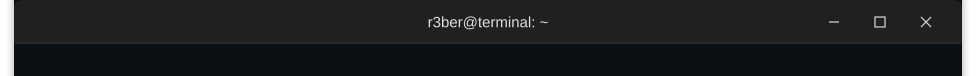
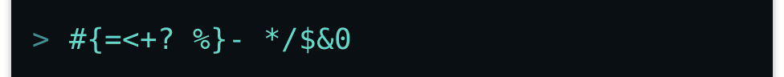
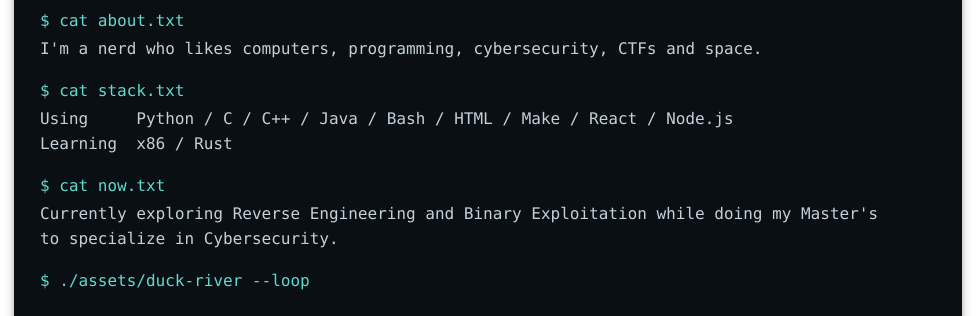
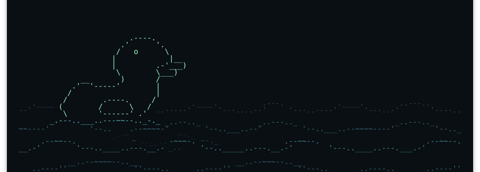

  <picture><source media="(max-width: 600px)" srcset="assets/terminal-header-mobile.svg"></picture> 
   
  <picture><source media="(max-width: 600px)" srcset="assets/terminal-profile-mobile.svg"></picture> 
   
  <picture><source media="(max-width: 600px)" srcset="assets/terminal-footer-mobile.svg"></picture>

